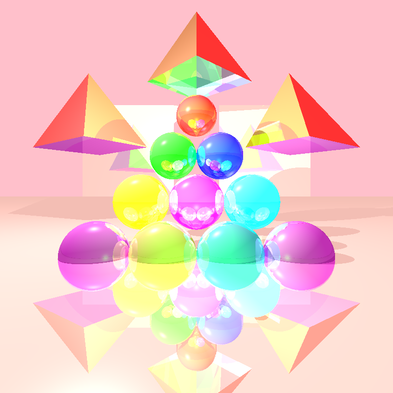

# Java Ray Tracer

A ray tracing rendering engine written from scratch in Java: geometry, lighting, shadows, reflection and refraction, with super-sampling anti-aliasing and multithreaded rendering.


> Course project, Introduction to Software Engineering, Jerusalem College of Technology (2023).

## Features

**Geometry**
- Sphere, plane, triangle, polygon, tube and cylinder
- Composite scenes with ray–object intersection for every shape

**Lighting and shading (Phong model)**
- Ambient, directional, point and spot lights
- Diffuse and specular reflection with configurable shininess
- Shadows, including partial shadows cast through transparent objects

**Global effects**
- Recursive reflection (mirrors) and refraction (transparency), up to 10 bounces
- Early cutoff when a ray's contribution drops below a threshold, to save computation

**Performance and image quality**
- Anti-aliasing with regular super-sampling (a grid of rays per pixel)
- **Adaptive super-sampling**: recursively subdivides a pixel only where neighboring samples differ, cutting the number of rays needed for smooth edges
- **Multithreaded rendering** across a configurable number of threads

## Gallery

| | |
|---|---|
|  |  |
|  |  |

## Design

```
primitives/   Point, Vector, Ray, Color, Material: core math and material types
geometries/   Intersectable shapes (Sphere, Plane, Triangle, Polygon, Tube, Cylinder)
lighting/     Ambient, directional, point and spot lights
scene/        Scene: geometries, lights and background
renderer/     Camera (ray construction, anti-aliasing, threads), RayTracerBasic, ImageWriter
```

- Object-oriented design with immutable primitives and chainable (fluent) setters for the camera and materials.
- Covered by **JUnit tests**: unit tests for every geometry and primitive, using equivalence partitions and boundary values, plus camera–geometry integration tests and render tests.

## Running

Open the project in IntelliJ IDEA and run the tests under `unitTests/renderer`. For example, `level7.java` renders the scenes shown above into the `images/` folder.

## Tech stack

Java · JUnit · IntelliJ IDEA

## Authors

Ori Shoshana and Amir Hai Tamar
